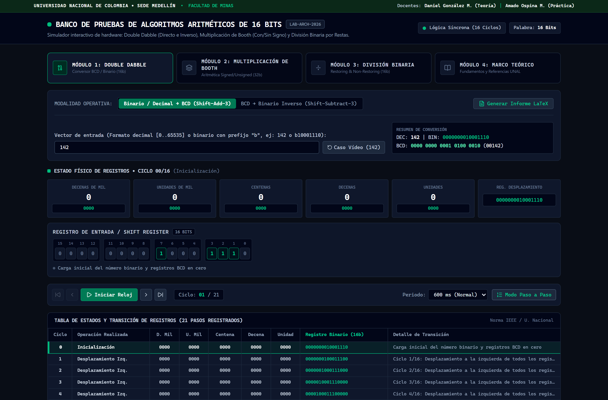
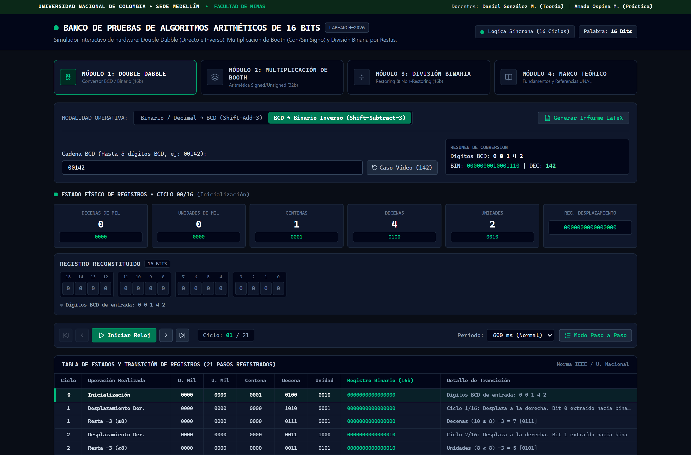
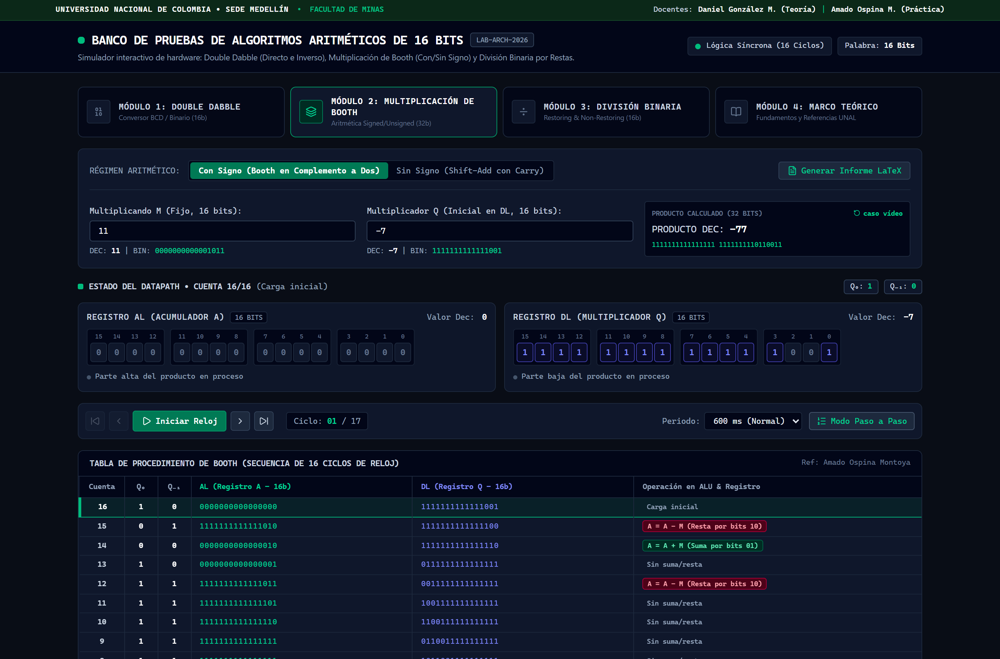
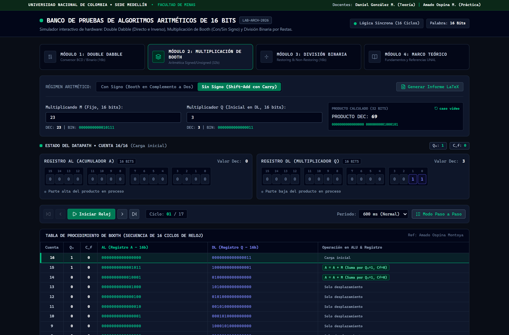
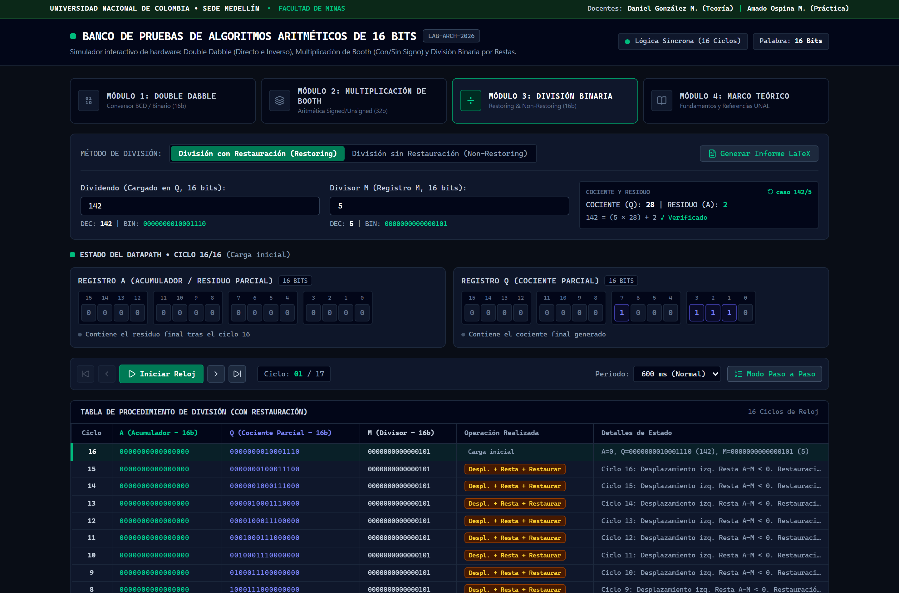
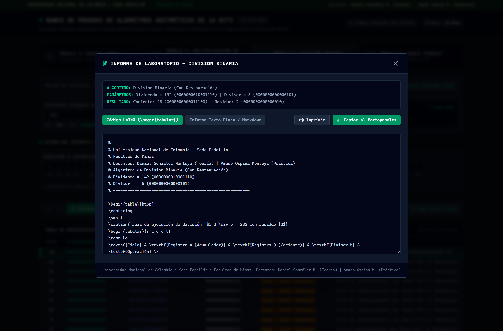
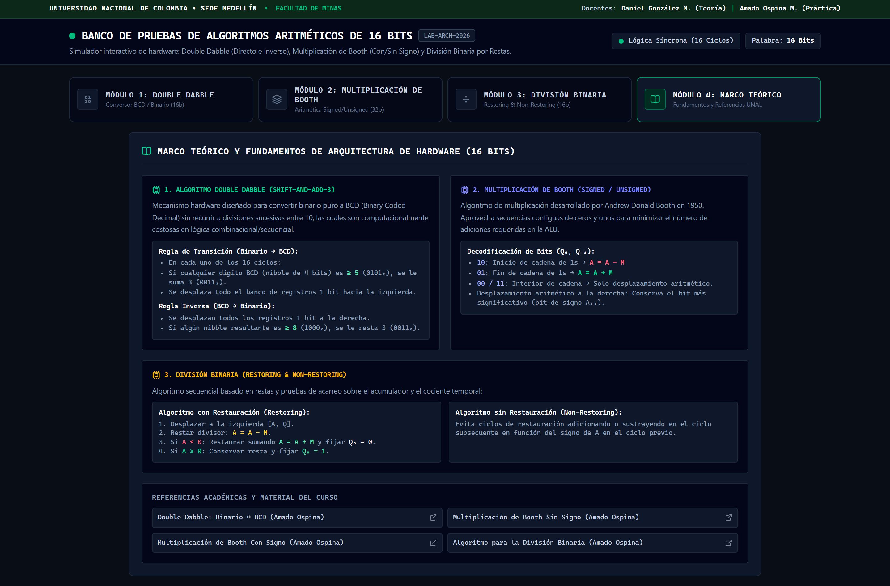

# Banco de Pruebas y Simulador de Algoritmos Aritméticos de 16 Bits ⚡

**Universidad Nacional de Colombia • Sede Medellín**  
**Facultad de Minas**  
**Asignatura:** Electrónica Digital / Arquitectura de Computadores  
**Docente de Teoría:** Ing. Daniel González Montoya  
**Docente de Práctica / Laboratorio:** Ing. Amado Ospina Montoya  

[](https://unal.edu.co)
[](https://vitejs.dev)
[](https://vercel.com)
[](https://minas.medellin.unal.edu.co)

---

## 1. Introducción y Propósito Académico

Este simulador es un banco de pruebas de instrumentación lógica y arquitectura de hardware diseñado para modelar ciclo a ciclo el comportamiento del *Datapath* (camino de datos), la Unidad Aritmética Lógica (ALU) y el secuenciador síncrono de reloj ($T_{clk}$) en el procesamiento de palabras de **16 bits**.

Implementa de forma interactiva y con traza completa los cuatro algoritmos fundamentales solicitados para la evaluación del 100% del curso:
1. **Double Dabble Directo (Binario a BCD):** Conversión sin divisiones mediante el algoritmo *Shift-and-Add-3*.
2. **Double Dabble Inverso (BCD a Binario):** Decodificación secuencial mediante el algoritmo *Shift-and-Subtract-3*.
3. **Multiplicación de Booth (32 bits de salida):** Implementación con signo en complemento a dos y sin signo con acarreo (*Shift-Add*).
4. **División Binaria (Cociente y Residuo):** Implementación con restauración (*Restoring*) y sin restauración (*Non-Restoring*).

---

## 2. Vista General de la Interfaz

La interfaz adopta una estética de banco de trabajo y analizador lógico de laboratorio, evitando elementos gráficos genéricos y priorizando la inspección bit a bit de cada registro.



### Características de la Interfaz:
* **Franja Institucional Oficial:** Identificación de la Universidad Nacional de Colombia - Sede Medellín, Facultad de Minas y los docentes del curso.
* **Selectores de Módulo:** Cuatro pestañas superiores para alternar entre Double Dabble, Multiplicación de Booth, División Binaria y Marco Teórico.
* **Banco de Registros Físicos (`RegisterGrid`):** Representación individual de cada flip-flop con sus índices de bit ($15$ a $0$) organizados en nibbles de 4 bits.
* **Compilador de Informes LaTeX:** Generación instantánea de tablas de estados en código LaTeX (`\begin{table}`) para Overleaf y texto plano.

---

## 3. Módulo 1: Algoritmo Double Dabble (Binario ↔ BCD)

Permite la conversión bidireccional entre binario puro de 16 bits ($0$ a $65535$) y código BCD (hasta 5 dígitos decimales: Decenas de mil a Unidades).

### 3.1. Modo Directo: Binario a BCD (Shift-and-Add-3)


* **Entrada de Datos:** En formato decimal (ej: `142`) o binario con prefijo `b` (ej: `b10001110`).
* **Botón Rápido:** Presione **"Caso Vídeo (142)"** para cargar en un clic el ejemplo explicado en las clases del profesor Amado Ospina.
* **Lógica de Transición:** En cada uno de los 16 ciclos:
  1. Si cualquier columna BCD es $\ge 5$, la compuerta sumadora le suma $+3$ (`+0011`).
  2. Todo el banco de registros se desplaza 1 bit a la izquierda.
* **Resultado:** Para $142$ genera los nibbles BCD `0000 0000 0001 0100 0010` ($0, 0, 1, 4, 2$).

---

### 3.2. Modo Inverso: BCD a Binario (Shift-and-Subtract-3)



* **Entrada BCD:** Ingrese la secuencia de hasta 5 dígitos BCD (ejemplo: `00142`).
* **Lógica Inversa:** Desplaza 1 bit a la derecha hacia el acumulador binario. Si en un ciclo intermedio algún nibble es $\ge 8$, sustrae $-3$ (`-0011`).
* **Reconstrucción:** Tras 16 ciclos se obtiene el binario exacto `0000000010001110` equivalente a `142` en decimal.

---

## 4. Módulo 2: Multiplicación con Algoritmo de Booth

Modela la multiplicación de hardware en 16 bits produciendo un resultado de 32 bits concatenado en los registros $[AL, DL]$.

### 4.1. Multiplicación Con Signo (Complemento a Dos)



* **Operandos:** Multiplicando $M$ (rango: $-32768$ a $32767$, ej: `11` o `b1011`) y Multiplicador $Q$ (ej: `-7`).
* **Decodificador de Booth $(Q_0, Q_{-1})$:**
  * `10`: Resta de la ALU: $A = A - M$.
  * `01`: Suma de la ALU: $A = A + M$.
  * `00` o `11`: Sin suma/resta.
  * **Desplazamiento Aritmético a la Derecha (SAR):** Desplaza $[A, Q, Q_{-1}]$ conservando el bit de signo de $A$.
* **Resultado:** Para $11 \times (-7) = -77$ (`11111111111111111111111110110011`).

---

### 4.2. Multiplicación Sin Signo (Shift-and-Add con Carry)



* **Lógica:** Evalúa $Q_0$. Si es 1, suma $A = A + M$ y actualiza la bandera de acarreo ($C_f$). Luego aplica desplazamiento lógico a la derecha de $[C_f, A, Q]$.
* **Ejemplo del Vídeo:** $23 \times 3 = 69$ (`00000000000000000000000001000101`).

---

## 5. Módulo 3: Algoritmo de División Binaria

Calcula el Cociente ($Q$) y el Residuo ($A$) para operandos de 16 bits mediante restas y desplazamientos sucesivos.



* **Modalidades:**
  * **Con Restauración (*Restoring*):** Si la resta $A - M < 0$, la ALU restaura $A = A + M$ y fija $Q_0 = 0$. Si es positiva o cero, fija $Q_0 = 1$.
  * **Sin Restauración (*Non-Restoring*):** Elimina el ciclo de restauración corrigiendo la operación en el ciclo subsecuente.
* **Comprobación Matemática Automática:** Valida que:
  $$\text{Dividendo} = (\text{Divisor} \times \text{Cociente}) + \text{Residuo}$$
  Para $142 \div 5$: $142 = (5 \times 28) + 2$ con un indicador de verificación exitosa.
* **Protección contra División por Cero:** Emite una advertencia visual bloqueando la operación inválida.

---

## 6. Controles del Secuenciador y Reloj de Hardware ($T_{clk}$)

Cada módulo incorpora controles de simulación síncrona:
* **$\mathbf{\vert\ll}$ (Primer Ciclo):** Reinicia los registros a su estado inicial.
* **$\mathbf{\langle}$ (Ciclo Anterior):** Retrocede un pulso de reloj para analizar estados previos.
* **Iniciar / Pausar Reloj:** Ejecuta la simulación de forma automática.
* **$\mathbf{\rangle}$ (Ciclo Siguiente):** Avanza un solo pulso de reloj.
* **$\mathbf{\gg\vert}$ (Último Ciclo):** Salta directamente al estado final.
* **Selector de Periodo:** Ajusta la velocidad entre 1000 ms, 600 ms o 200 ms.
* **Modo Paso a Paso / Todos:** Permite alternar entre inspeccionar únicamente el ciclo activo o desplegar la tabla completa de 16 ciclos.

---

## 7. Generador de Informes de Laboratorio en LaTeX

Para agilizar la redacción de informes formales y artículos técnicos en la Facultad de Minas, el simulador incluye un compilador de tablas de estados.



* **Exportación en 1 Clic:** Presione **"Generar Informe LaTeX"** en cualquier módulo.
* **Pestaña LaTeX:** Entrega el código con entorno `\begin{table}`, `\caption`, `\toprule`, `\midrule`, etiquetas de columnas y formato tabular para copiar y pegar en **Overleaf**.
* **Pestaña Texto Plano / ASCII:** Tabla formateada en texto para informes en Word o Markdown.
* **Botón Imprimir:** Formato de impresión directa en PDF.

---

## 8. Módulo 4: Marco Teórico y Referencias Académicas

Condensa los fundamentos teóricos, las ecuaciones de transferencia de registros y los enlaces directos a las clases grabadas del profesor Amado Ospina Montoya.



---

## 9. Instrucciones de Ejecución Local

### Requisitos Previos:
* [Node.js](https://nodejs.org/) (versión 18 o superior recomendada).
* Gestor de paquetes `npm`.

### Paso 1: Clonar e Ingresar al Directorio
```bash
git clone https://github.com/TU_USUARIO/algoritmos-digitales.git
cd algoritmos-digitales
```

### Paso 2: Instalar Dependencias
```bash
npm install
```

### Paso 3: Iniciar el Servidor de Desarrollo
```bash
npm run dev
```
Abra en su navegador la URL indicada en la consola (usualmente `http://localhost:5173`).

### Paso 4: Compilación para Producción
Para verificar el empaquetado optimizado para distribución:
```bash
npm run build
```
Los archivos finales se generarán en la carpeta `dist/`.

### Paso 5: Generación Automatizada de Capturas
El proyecto incluye un script automatizado con Puppeteer y Chrome para capturar imágenes en alta resolución de cada pantalla:
```bash
node scripts/capture_screenshots.cjs
```
Las capturas se guardarán automáticamente en `docs/images/`.

---

## 10. Despliegue en la Nube (Vercel)

La aplicación posee una arquitectura 100% *Client-Side* (sin requerir servidores externos ni bases de datos), por lo que su despliegue en Vercel es instantáneo:

### Opción A: Vía GitHub (Recomendada)
1. Suba los cambios a su repositorio en GitHub:
   ```bash
   git add .
   git commit -m "feat: proyecto completo listo para evaluacion"
   git branch -M main
   git push -u origin main
   ```
2. Inicie sesión en [vercel.com](https://vercel.com) e importe el repositorio.
3. Haga clic en **"Deploy"**. Vercel compilará la aplicación y generará una URL pública y segura (`.vercel.app`).

### Opción B: Vía Vercel CLI
```bash
npx vercel
```
Siga las instrucciones en la consola para desplegar en menos de 1 minuto.

---

## 11. Créditos y Autoría

* **Institución:** Universidad Nacional de Colombia • Sede Medellín
* **Facultad:** Facultad de Minas
* **Docente de Teoría:** Ing. Daniel González Montoya
* **Docente de Práctica / Laboratorio:** Ing. Amado Ospina Montoya
* **Asignatura:** Electrónica Digital / Arquitectura de Computadores
