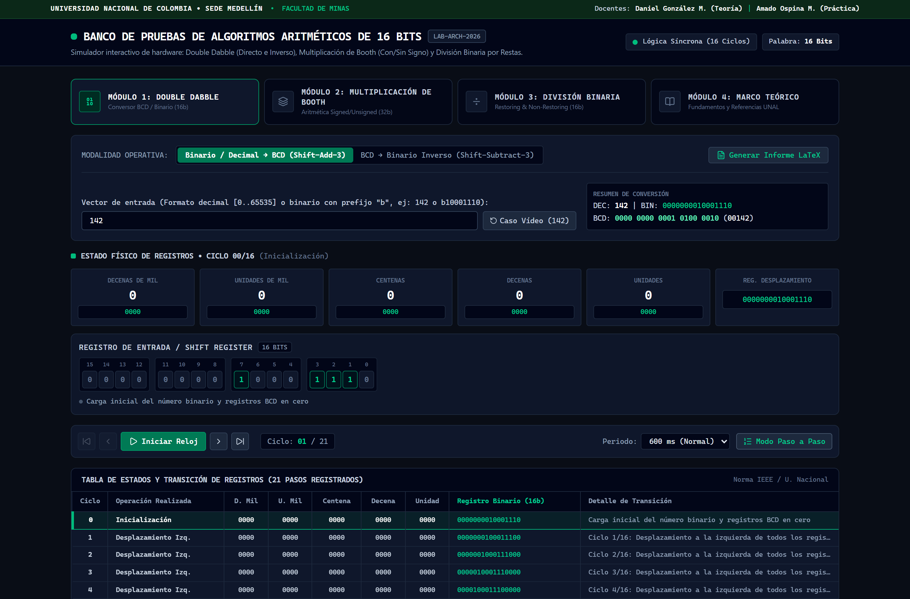
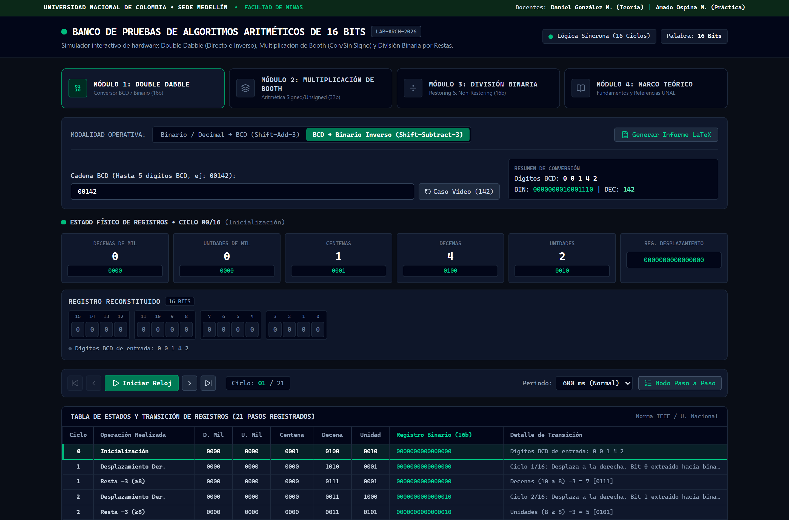
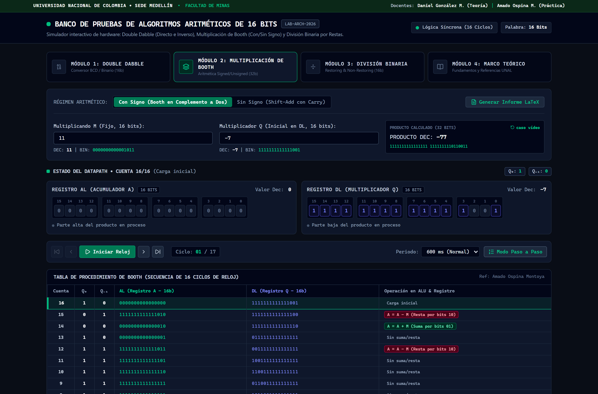
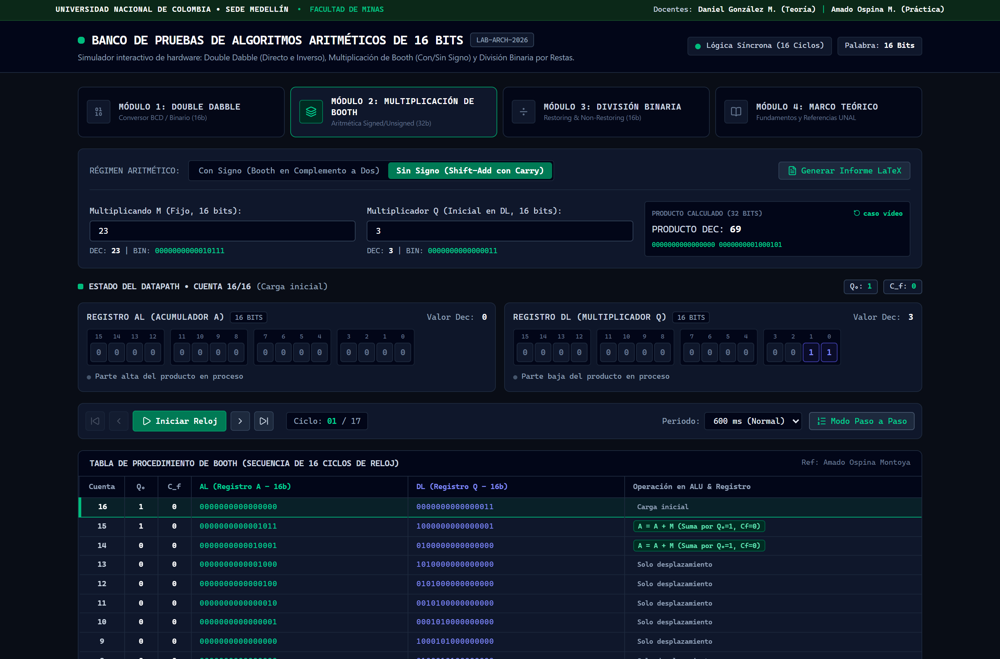
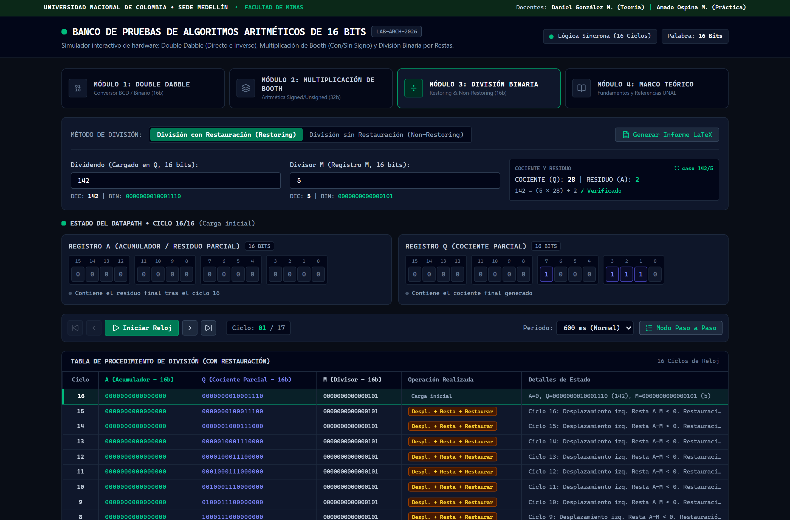
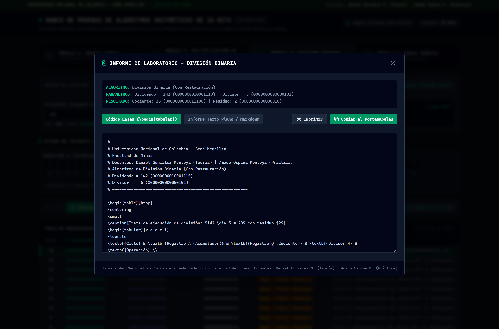
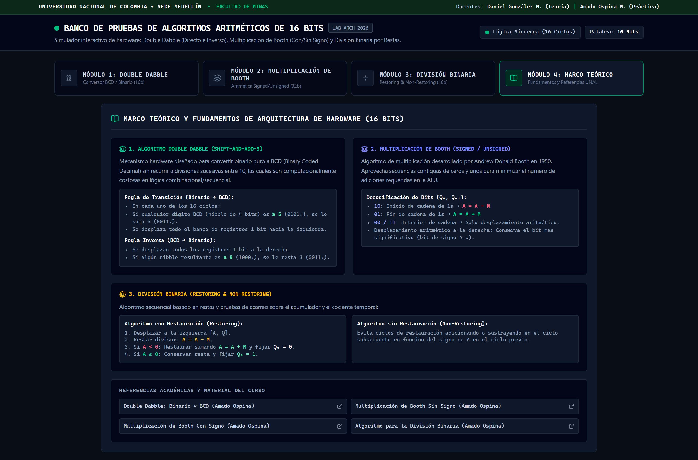

# MANUAL DE USUARIO
## SIMULADOR Y BANCO DE PRUEBAS DE ALGORITMOS ARITMÉTICOS DE 16 BITS

**Universidad Nacional de Colombia • Sede Medellín**  
**Facultad de Minas**  
**Asignatura:** Electrónica Digital / Arquitectura de Computadores  
**Docente de Teoría:** Ing. Daniel González Montoya  
**Docente de Práctica / Laboratorio:** Ing. Amado Ospina Montoya  

---

## 1. INTRODUCCIÓN Y ALCANCE

El presente simulador es una herramienta interactiva de análisis a nivel de arquitectura de hardware, desarrollada para modelar el comportamiento del *Datapath* (camino de datos), la Unidad Aritmética Lógica (ALU) y el secuenciador síncrono de reloj ($T_{clk}$) en el procesamiento de palabras digitales de **16 bits**.

El software cubre y valida ciclo a ciclo los cuatro algoritmos fundamentales solicitados en la propuesta de laboratorio:
1. **Double Dabble Directo:** Conversión de binario puro a código BCD (*Shift-and-Add-3*).
2. **Double Dabble Inverso:** Decodificación de BCD hacia binario puro (*Shift-and-Subtract-3*).
3. **Multiplicación de Booth:** Implementación con signo en complemento a dos y sin signo con acarreo (*Shift-Add*).
4. **División Binaria:** Implementación con restauración (*Restoring*) y sin restauración (*Non-Restoring*).

---

## 2. ARQUITECTURA DE LA INTERFAZ GENERAL

La interfaz ha sido diseñada bajo estándares de instrumentación de laboratorio y analizadores lógicos, priorizando la densidad de datos, la claridad tipográfica y la inspección bit a bit.



### Elementos de la Barra Superior:
* **Franja Institucional:** Identifica la Universidad Nacional de Colombia - Sede Medellín, la Facultad de Minas y los docentes a cargo.
* **Selectores de Módulo:** Cuatro pestañas superiores permiten alternar instantáneamente entre los algoritmos y el marco teórico.
* **Indicadores de Estado:** Muestra el régimen de palabra activa (16 bits) y el modo de sincronismo de reloj.

---

## 3. MÓDULO 1: ALGORITMO DOUBLE DABBLE (BINARIO ↔ BCD)

Este módulo permite convertir números enteros de hasta 16 bits ($0$ a $65535$) a formato BCD (hasta 5 dígitos decimales: Decenas de mil, Unidades de mil, Centenas, Decenas y Unidades) sin requerir costosas divisiones entre 10.

### 3.1. Modo Directo: Binario a BCD (Shift-and-Add-3)


#### Instrucciones de Uso:
1. Seleccione la opción **"Binario / Decimal → BCD (Shift-Add-3)"**.
2. Ingrese el número en el campo de texto:
   * **En Decimal:** Ingrese el valor directo entre 0 y 65535 (ejemplo: `142`).
   * **En Binario:** Anteponga la letra `b` seguida de los bits (ejemplo: `b10001110`).
   * También puede presionar el botón **"Caso Vídeo (142)"** para cargar el ejemplo de clase en un clic.
3. Observe en tiempo real la síntesis del resultado:
   * Representación decimal y binaria de 16 bits.
   * Representación BCD agrupada por nibbles: `0000 0000 0001 0100 0010` ($0, 0, 1, 4, 2$).
4. **Inspección de Registros Físicos:** El panel central muestra los 5 dígitos BCD individuales y el banco de flip-flops físicos con sus índices de bit ($15$ al $0$).
5. **Regla de Transición:** En cada uno de los 16 ciclos:
   * Si cualquier columna BCD es $\ge 5$, la compuerta sumadora le suma $+3$ (`+0011`).
   * Todo el banco se desplaza 1 bit a la izquierda.

---

### 3.2. Modo Inverso: BCD a Binario (Shift-and-Subtract-3)



#### Instrucciones de Uso:
1. Seleccione la opción **"BCD → Binario Inverso (Shift-Subtract-3)"**.
2. Ingrese la secuencia de hasta 5 dígitos BCD (ejemplo: `00142`).
3. El simulador realiza el proceso matemático inverso:
   * Desplaza todos los registros 1 bit a la derecha hacia el acumulador binario.
   * Si en cualquier ciclo intermedio algún nibble BCD es $\ge 8$, se sustrae $-3$ (`-0011`).
4. Al completarse los 16 ciclos, el acumulador binario contiene el número reconstruido exacto (`142` en decimal, `0000000010001110` en binario).

---

## 4. MÓDULO 2: MULTIPLICACIÓN CON ALGORITMO DE BOOTH

Modela la multiplicación de hardware en 16 bits produciendo un resultado de 32 bits concatenado en los registros $[AL, DL]$.

### 4.1. Multiplicación Con Signo (Complemento a Dos)



#### Instrucciones de Uso:
1. Seleccione la opción **"Con Signo (Booth en Complemento a Dos)"**.
2. Ingrese el **Multiplicando $M$** (rango: $-32768$ a $32767$, ej: `11` o `b1011`).
3. Ingrese el **Multiplicador $Q$** (rango: $-32768$ a $32767$, ej: `-7`).
   * *Tip:* Puede presionar el botón **"caso vídeo"** para cargar `11 × -7`.
4. El simulador ejecuta 16 ciclos de reloj evaluando en cada paso el par de bits $(Q_0, Q_{-1})$:
   * `10`: Resta de la ALU: $A = A - M$.
   * `01`: Suma de la ALU: $A = A + M$.
   * `00` o `11`: Sin suma/resta.
   * **Desplazamiento Aritmético a la Derecha (SAR):** Desplaza $[A, Q, Q_{-1}]$ conservando el bit de signo de $A$.
5. **Resultado Final de 32 Bits:**
   * Parte Alta ($AL$): 16 bits superiores del producto.
   * Parte Baja ($DL$): 16 bits inferiores del producto.
   * Para $11 \times (-7)$, el resultado es $-77$ (`11111111111111111111111110110011`).

---

### 4.2. Multiplicación Sin Signo (Shift-and-Add con Carry)



#### Instrucciones de Uso:
1. Seleccione la opción **"Sin Signo (Shift-Add con Carry)"**.
2. Ingrese operandos positivos de 16 bits (rango: $0$ a $65535$, ej: $23$ y $3$).
3. La ALU evalúa el bit $Q_0$:
   * Si $Q_0 = 1$: Suma $A = A + M$ y registra el desbordamiento en la bandera de acarreo ($C_f$).
   * Desplazamiento lógico a la derecha de $[C_f, A, Q]$.
4. Para $23 \times 3$, el resultado final es $69$ (`00000000000000000000000001000101`).

---

## 5. MÓDULO 3: DIVISIÓN BINARIA (RESTORING & NON-RESTORING)

Calcula el cociente ($Q$) y el residuo ($A$) a partir de un Dividendo y un Divisor de 16 bits mediante restas y desplazamientos sucesivos.



#### Instrucciones de Uso:
1. Seleccione la modalidad:
   * **División con Restauración (*Restoring*):** Si la resta $A - M$ es negativa, la ALU deshace la resta sumando $A = A + M$ y fija $Q_0 = 0$. Si es positiva o cero, conserva el valor y fija $Q_0 = 1$.
   * **División sin Restauración (*Non-Restoring*):** Evita ciclos de restauración adicionando o sustrayendo en el ciclo siguiente según el signo del acumulador.
2. Ingrese el **Dividendo** (ej: `142` o `b10001110`) y el **Divisor** (ej: `5`).
   * *Validación de Seguridad:* Si el divisor es 0, el simulador emite una advertencia de "División por cero no permitida" protegiendo el cálculo.
3. **Comprobación Matemática Automática:**
   El sistema verifica automáticamente el Teorema de Euclides:
   $$\text{Dividendo} = (\text{Divisor} \times \text{Cociente}) + \text{Residuo}$$
   Para $142 \div 5$: $142 = (5 \times 28) + 2$ con un indicador de verificación exitosa.

---

## 6. CONTROLES DEL SECUENCIADOR Y RELOJ DE HARDWARE ($T_{clk}$)

Cada módulo incorpora una barra de control de reloj que permite reproducir y estudiar el algoritmo paso a paso como si se operara un generador de pulsos de laboratorio:

| Control | Función |
| :--- | :--- |
| **`Primer Ciclo` ($\mathbf{\vert\ll}$)** | Reinicia los registros a su estado inicial ($T_0$ o $T_{16}$). |
| **`Ciclo Anterior` ($\mathbf{\langle}$)** | Retrocede un pulso de reloj para revisar el estado previo de los flip-flops. |
| **`Iniciar / Pausar Reloj`** | Ejecuta la simulación de forma automática continua. |
| **`Ciclo Siguiente` ($\mathbf{\rangle}$)** | Avanza un solo pulso de reloj para estudiar la microoperación inmediata. |
| **`Último Ciclo` ($\mathbf{\gg\vert}$)** | Salta directamente al estado final con los resultados calculados. |
| **`Selector de Periodo`** | Modifica la velocidad del reloj: 1000 ms (análisis detallado), 600 ms (normal) o 200 ms (rápido). |
| **`Modo Paso a Paso / Todos`** | Alterna entre inspeccionar únicamente el ciclo activo o visualizar la tabla completa de 16 ciclos. |

---

## 7. GENERADOR DE INFORMES DE LABORATORIO EN LATEX

Para agilizar la entrega de informes formales y artículos técnicos en la Facultad de Minas, el simulador incluye un compilador de tablas en código LaTeX y texto plano.



#### Pasos para exportar:
1. En cualquiera de los módulos, presione el botón **"Generar Informe LaTeX"**.
2. Se desplegará la ventana modal con:
   * Encabezado institucional oficial: Universidad Nacional de Colombia - Sede Medellín, Facultad de Minas, y los nombres de los docentes.
   * **Pestaña LaTeX:** Código listo con entorno `\begin{table}`, `\caption`, `\toprule`, `\midrule`, etiquetas de columnas y formato tabular para Overleaf.
   * **Pestaña Texto / ASCII:** Tabla formateada en texto plano para pegar en documentos Word, correos o informes Markdown.
3. Presione **"Copiar al Portapapeles"** o **"Imprimir"** para exportar de inmediato.

---

## 8. MÓDULO 4: MARCO TEÓRICO Y REFERENCIAS ACADÉMICAS

El cuarto módulo condensa los fundamentos teóricos, las ecuaciones de transferencia de registros y los enlaces directos a las grabaciones de clase del profesor Amado Ospina Montoya.



---

## 9. GUÍA DE EJECUCIÓN Y DESPLIEGUE

### 9.1. Ejecución Local en Entorno de Desarrollo
Para ejecutar el software localmente en cualquier computador con Node.js:
```powershell
cd "C:\Users\USER\Documents\universidad\electronica digital\algoritmos-digitales"
npm install
npm run dev
```
Abrir el navegador en `http://localhost:5173`.

### 9.2. Despliegue en la Nube (Vercel)
El proyecto cuenta con arquitectura 100% *Client-Side* (sin requerir servidores externos ni bases de datos), por lo que su despliegue en Vercel es instantáneo:

1. Subir los cambios a GitHub:
   ```bash
   git add .
   git commit -m "docs: manual de usuario completo con imagenes y capturas"
   git remote add origin https://github.com/TU_USUARIO/TU_REPOSITORIO.git
   git push -u origin main
   ```
2. Iniciar sesión en [vercel.com](https://vercel.com) e importar el repositorio.
3. Presionar **"Deploy"**. Vercel compilará la aplicación y entregará una URL pública y segura (`.vercel.app`) accesible desde computadores, tablets y teléfonos móviles.

---

*Manual elaborado para la Facultad de Minas • Universidad Nacional de Colombia • Sede Medellín.*
